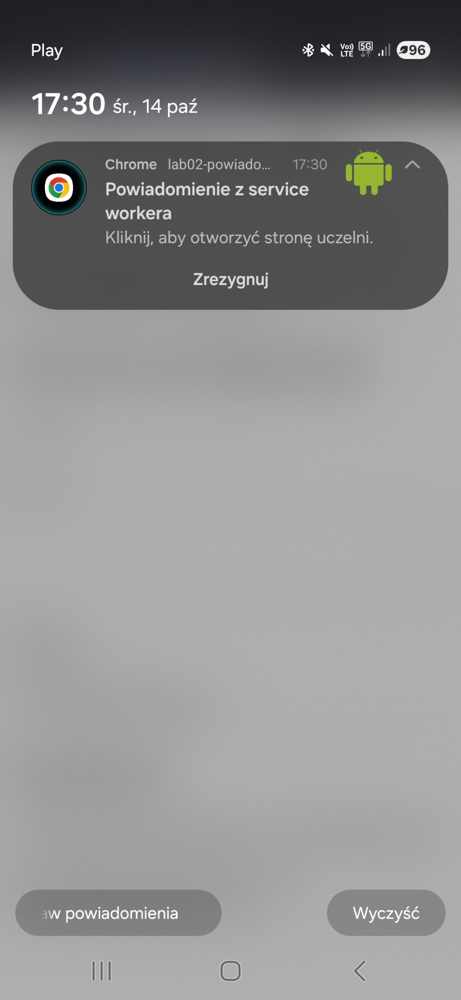
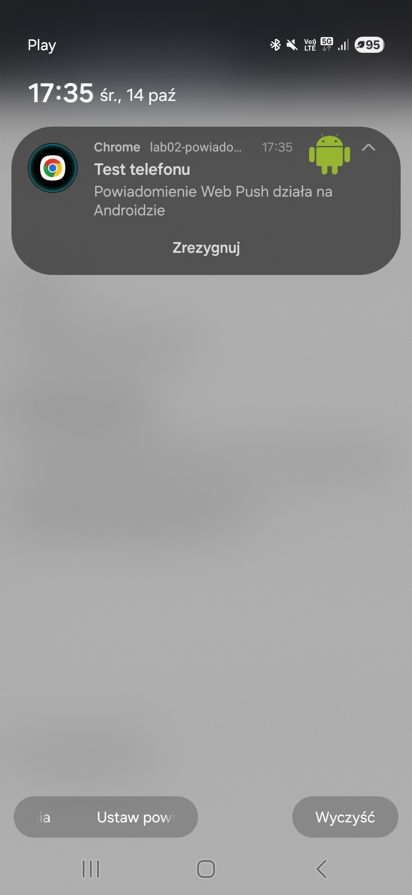

# Lab 02 – Powiadomienia i Web Push

## Co zostało zrealizowane

W ramach laboratorium została przygotowana aplikacja webowa obsługująca powiadomienia w przeglądarce.

Zrealizowane elementy:

- obsługa uprawnień do powiadomień,
- wyświetlanie aktualnego stanu uprawnień,
- lokalne powiadomienie za pomocą Notification API,
- powiadomienie wyświetlane przez service workera,
- formularz do tworzenia własnego powiadomienia,
- możliwość podania tytułu i treści powiadomienia,
- wybór jednej z trzech ikon powiadomienia,
- obsługa kliknięcia w powiadomienie,
- subskrypcja i anulowanie subskrypcji Web Push,
- generowanie kluczy VAPID,
- wysyłanie powiadomień Web Push z poziomu Node.js,
- działanie Web Push po zamknięciu karty przeglądarki,
- publikacja aplikacji w Firebase Hosting,
- test działania powiadomień Web Push na telefonie z Androidem.

Aplikacja została opublikowana pod adresem:

https://lab02-powiadomienia.web.app

## Uruchomienie

Aby uruchomić aplikację lokalnie, należy przejść do katalogu `public`:

```powershell
cd public
```

Następnie uruchomić lokalny serwer:

```powershell
npx.cmd serve -l 3001
```

Aplikacja będzie dostępna pod adresem:

```text
http://localhost:3001
```

Do wysyłania Web Push potrzebne są pliki `vapid-keys.json` oraz `subscription.json`. Pliki te nie są przechowywane w repozytorium.

Powiadomienie można wysłać poleceniem:

```powershell
node send-push.mjs "Nowa wiadomość" "Pozdrowienia z serwera!"
```

Poprawna wysyłka zwraca status:

```text
201
```

## Test na telefonie

Powiadomienia zostały również przetestowane na urządzeniu z systemem Android.

Powiadomienie z service workera:



Powiadomienie Web Push wysłane z serwera:



## Trudności / refleksja

Podczas wykonywania laboratorium ważne było rozróżnienie lokalnych powiadomień od Web Push. W przypadku Web Push konieczne było utworzenie subskrypcji dla konkretnego urządzenia oraz użycie kluczy VAPID. Dzięki service workerowi powiadomienie może zostać odebrane również wtedy, gdy karta aplikacji jest zamknięta.
