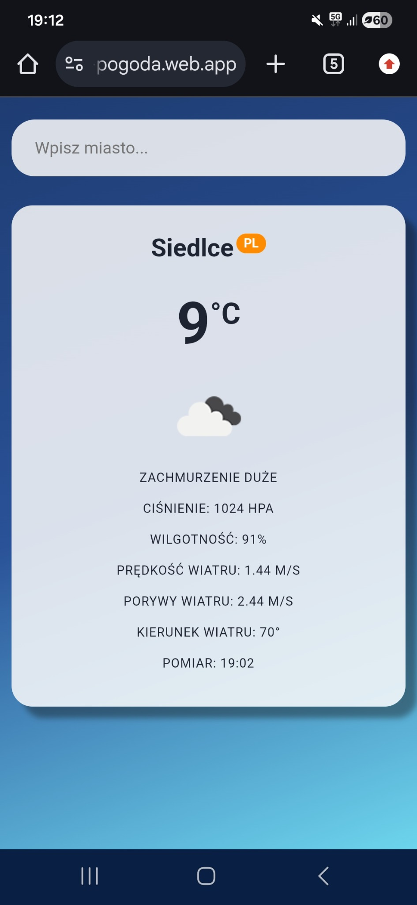
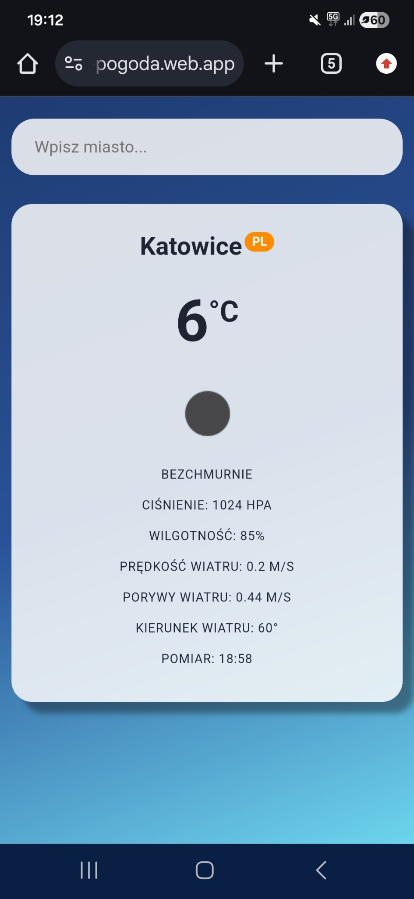
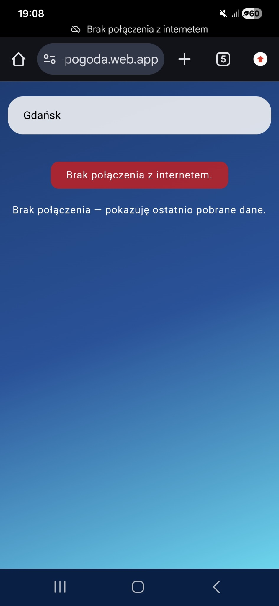

# Lab 03 - Weather App / PWA

## Co zostało zrealizowane

W ramach laboratorium została przygotowana aplikacja pogodowa w React z wykorzystaniem Vite i API OpenWeatherMap.

Zrealizowane elementy:

- wyszukiwanie pogody dla wpisanego miasta,
- pobieranie danych z OpenWeatherMap za pomocą `fetch()`,
- obsługa błędów połączenia i nieistniejącego miasta,
- wyświetlanie temperatury,
- wyświetlanie ikony i opisu pogody,
- wyświetlanie ciśnienia atmosferycznego,
- wyświetlanie wilgotności,
- wyświetlanie prędkości i porywów wiatru,
- wyświetlanie kierunku wiatru,
- wyświetlanie godziny pomiaru,
- wykrywanie stanu online/offline,
- konfiguracja PWA za pomocą `vite-plugin-pwa`,
- buforowanie odpowiedzi API strategią `NetworkFirst`,
- buforowanie ikon pogody strategią `CacheFirst`,
- działanie aplikacji offline dla wcześniej pobranych danych,
- instalacja aplikacji jako PWA,
- publikacja aplikacji w Firebase Hosting,
- test działania aplikacji na telefonie.

Aplikacja została opublikowana pod adresem:

https://lab03-pogoda.web.app

## Uruchomienie

Po pobraniu projektu należy zainstalować zależności:

```powershell
npm install
```

Następnie zbudować wersję produkcyjną:

```powershell
npm run build
```

Uruchomienie podglądu wersji produkcyjnej:

```powershell
npm run preview
```

Aplikacja będzie dostępna domyślnie pod adresem:

```text
http://localhost:4173
```

## Tryb offline

Service worker zapisuje pliki aplikacji oraz odpowiedzi z API w pamięci cache.

Dla danych pogodowych używana jest strategia `NetworkFirst`. Aplikacja najpierw próbuje pobrać aktualne dane z sieci, a jeśli połączenie nie jest dostępne, może wyświetlić ostatnio zapisaną odpowiedź dla wcześniej wyszukanego miasta.

Jeśli użytkownik jest offline i wyszuka miasto, którego wcześniej nie pobrano, wyświetlany jest komunikat o braku połączenia z internetem.

## Zrzuty ekranu z telefonu

### Pogoda dla Siedlec



### Pogoda dla Katowic



### Brak połączenia z internetem



## Trudności / refleksja

Najważniejszą częścią laboratorium było połączenie aplikacji React z zewnętrznym API oraz przygotowanie działania offline. Dzięki service workerowi i strategii `NetworkFirst` aplikacja może korzystać z wcześniej zapisanych danych również wtedy, gdy połączenie z internetem zostanie utracone.
