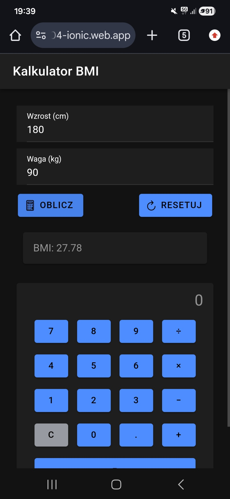
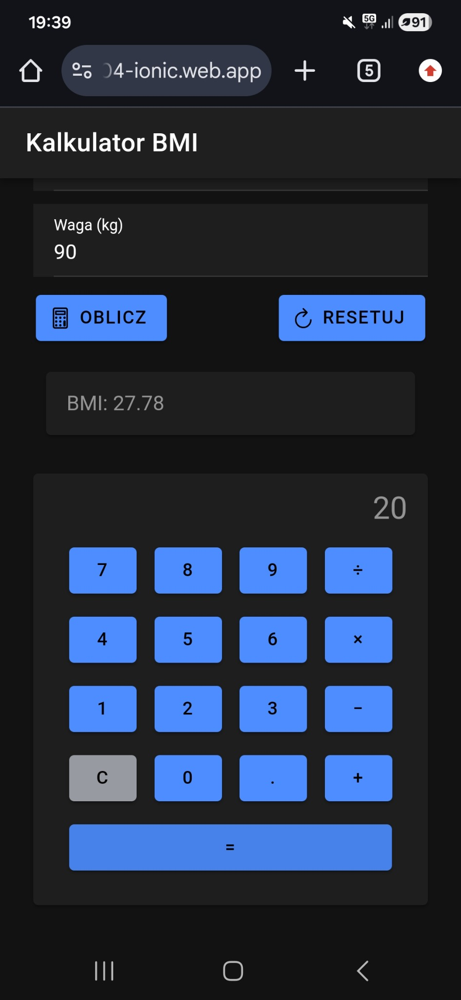

# Lab 04 – Ionic React – kalkulatory

## Co zostało zrealizowane

W ramach laboratorium została przygotowana pierwsza aplikacja w Ionic React.

Zrealizowane elementy:

- utworzenie projektu Ionic React,
- wykorzystanie podstawowych komponentów Ionic,
- kalkulator BMI z polami wzrostu i wagi,
- obliczanie BMI na podstawie podanych danych,
- wyświetlanie wyniku BMI w komponencie `IonCard`,
- resetowanie pól i wyniku,
- wykorzystanie hooków `useRef` i `useState`,
- użycie ikon z `ionicons`,
- utworzenie osobnego komponentu `Kalkulator`,
- kalkulator z podstawowymi działaniami: dodawanie, odejmowanie, mnożenie i dzielenie,
- obsługa liczb dziesiętnych,
- blokowanie drugiej kropki w jednej liczbie,
- możliwość wykorzystania wyniku w kolejnym działaniu,
- obsługa dzielenia przez zero bez użycia `eval()`.

## Uruchomienie

Po pobraniu projektu należy zainstalować zależności:

```powershell
npm install
```

Następnie uruchomić aplikację:

```powershell
ionic serve
```

Aplikacja będzie dostępna domyślnie pod adresem:

```text
http://localhost:8100
```

## Kalkulator BMI

Kalkulator BMI pobiera wzrost w centymetrach oraz wagę w kilogramach. Po kliknięciu przycisku `Oblicz` wynik jest wyświetlany z dokładnością do dwóch miejsc po przecinku.

Przycisk `Resetuj` czyści oba pola oraz ukrywa wynik.

### Zrzut ekranu – kalkulator BMI



## Kalkulator

Drugi kalkulator został utworzony jako osobny komponent `Kalkulator.tsx`.

Obsługuje działania:

- dodawanie,
- odejmowanie,
- mnożenie,
- dzielenie.

Przycisk `C` czyści kalkulator. W przypadku dzielenia przez zero wyświetlany jest komunikat:

```text
Nie można dzielić przez zero
```

### Zrzut ekranu – kalkulator z wynikiem



## Trudności / refleksja

Najważniejszą częścią laboratorium było poznanie komponentów Ionic oraz sposobu przechowywania i odczytywania danych w React za pomocą `useRef` i `useState`. Osobny komponent kalkulatora pozwolił również uporządkować kod i oddzielić jego logikę od głównego komponentu aplikacji.
