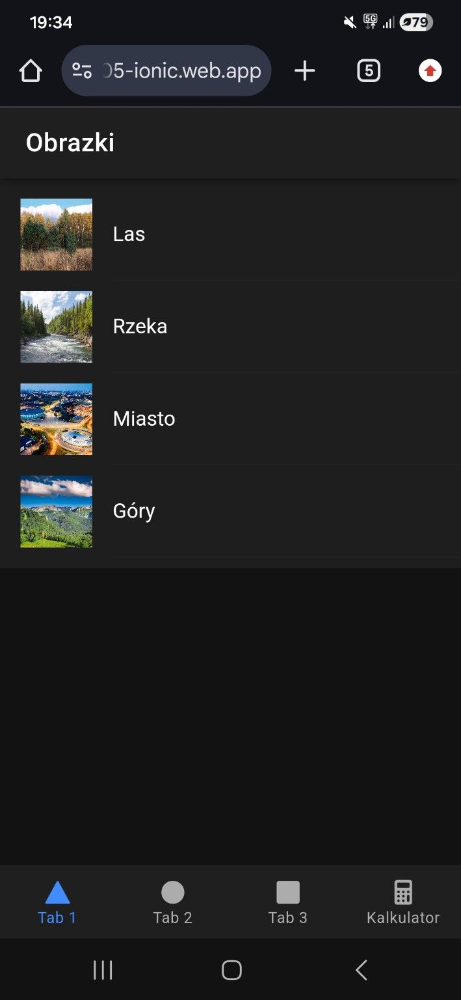
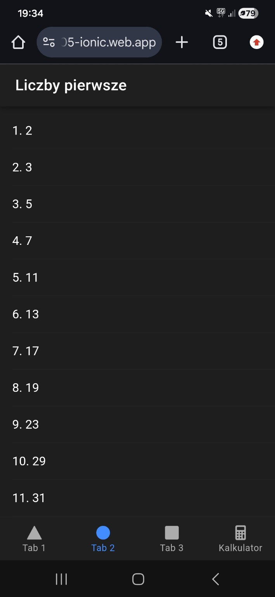
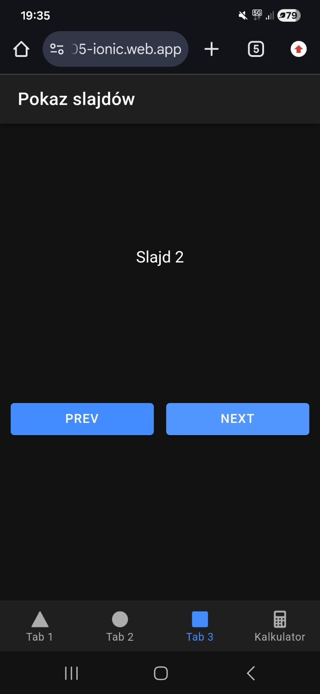
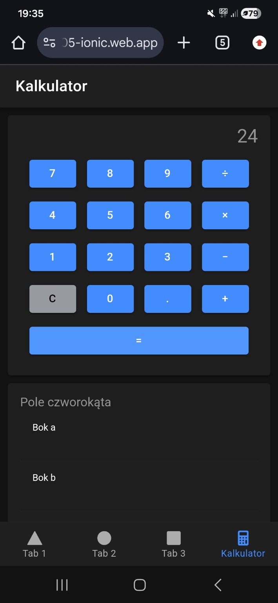
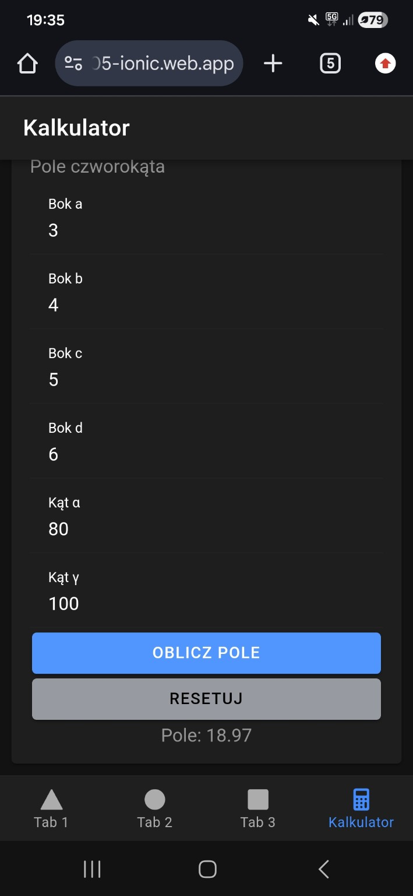

# Lab 05 – Podstawowe komponenty Ionic React

## Co zostało zrealizowane

W ramach laboratorium została utworzona aplikacja Ionic React oparta na zakładkach.

Zrealizowane zostały:

- dodanie czwartej zakładki „Kalkulator”,
- przeniesienie kalkulatora z poprzedniego laboratorium,
- obsługa dzielenia przez zero za pomocą `IonAlert`,
- lista obrazków utworzona z tablicy danych przy użyciu `map`,
- lista liczb pierwszych z nieskończonym przewijaniem `IonInfiniteScroll`,
- komunikat `IonToast` po doładowaniu kolejnych liczb,
- pokaz slajdów z użyciem biblioteki Swiper,
- sterowanie slajdami przyciskami PREV i NEXT,
- obliczanie pola czworokąta ze wzoru Bretschneidera.

## Uruchomienie

Po pobraniu projektu należy zainstalować zależności:

```bash
npm install
```

Następnie uruchomić aplikację:

```bash
ionic serve
```

Aplikacja uruchamia się pod adresem:

```text
http://localhost:8100
```

Wersja wdrożona na Firebase Hosting:

```text
https://lab05-ionic.web.app
```

## Lista obrazków

Na pierwszej zakładce znajduje się lista obrazków z podpisami.



## Liczby pierwsze

Na drugiej zakładce znajduje się lista kolejnych liczb pierwszych. Po przewinięciu do końca listy ładowane są kolejne elementy.



## Pokaz slajdów

Na trzeciej zakładce znajduje się pokaz slajdów wykonany przy użyciu biblioteki Swiper. Slajdy można zmieniać gestem lub przyciskami PREV i NEXT.



## Kalkulator

Na zakładce „Kalkulator” znajduje się kalkulator wykonujący podstawowe działania matematyczne. Przy próbie dzielenia przez zero wyświetlany jest komunikat `IonAlert`.



## Pole czworokąta

Pod kalkulatorem znajduje się formularz obliczający pole dowolnego czworokąta wypukłego za pomocą wzoru Bretschneidera.

Dla przykładowych danych:

- a = 3
- b = 4
- c = 5
- d = 6
- α = 80°
- γ = 100°

wynik wynosi:

```text
Pole: 18.97
```



## Trudności / refleksja

Najwięcej uwagi wymagała obsługa `IonInfiniteScroll`, integracja biblioteki Swiper oraz poprawne przygotowanie projektu do wdrożenia na Firebase Hosting. Przydatne było również rozdzielenie poszczególnych funkcjonalności na osobne komponenty i strony.
