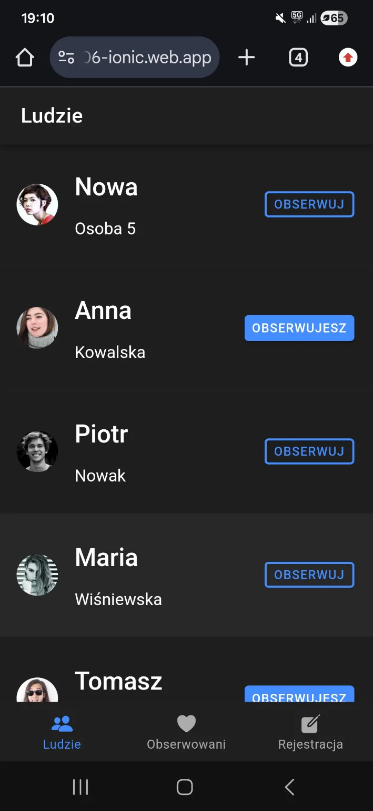
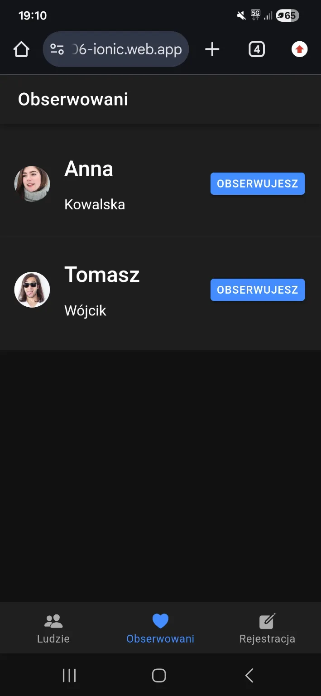
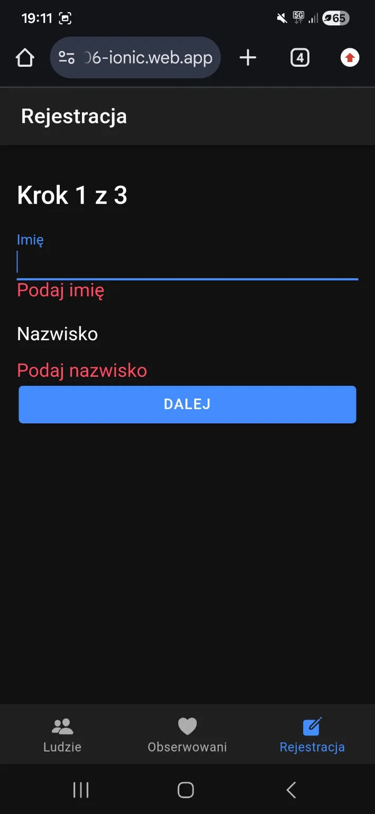
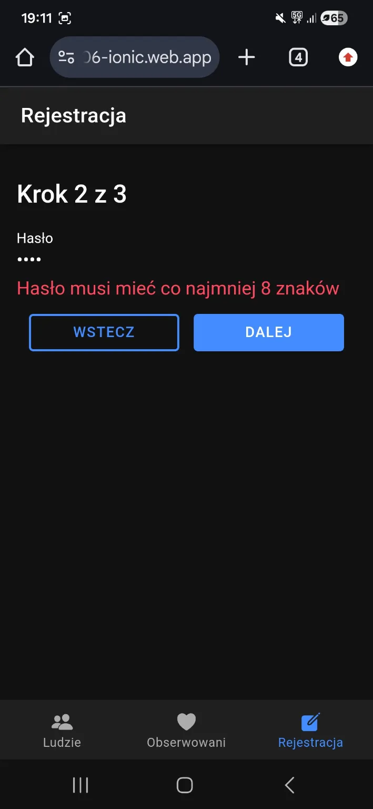
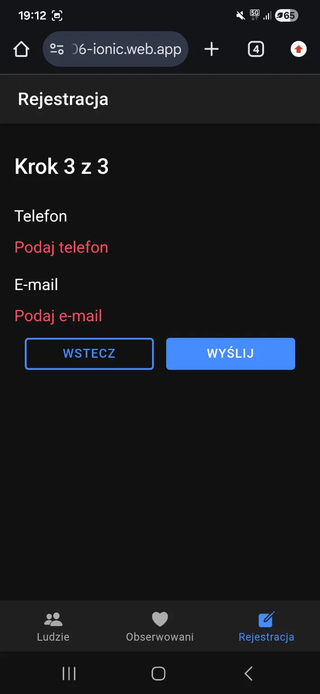
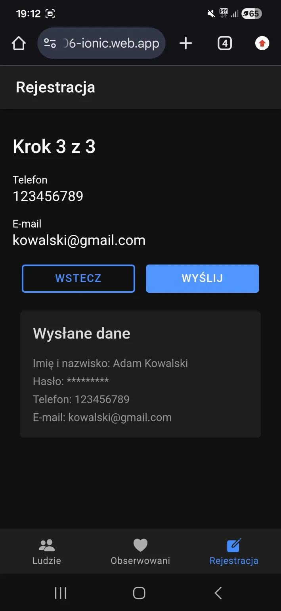

# Lab 06 – Nawigacja, wspólny stan i formularze w Ionic React

## Co zostało zrealizowane

W ramach laboratorium została utworzona aplikacja Ionic React z trzema zakładkami:

- Ludzie,
- Obserwowani,
- Rejestracja.

Zrealizowane zostały:

- wspólny stan aplikacji przy użyciu biblioteki Zustand,
- lista osób z możliwością obserwowania i cofania obserwowania,
- lista obserwowanych osób,
- routing z parametrem i widok szczegółów osoby,
- powrót do listy przyciskiem wstecz,
- odświeżanie listy przez `IonRefresher`,
- formularz krokowy z użyciem `react-hook-form`,
- walidacja danych formularza,
- przechodzenie między krokami formularza przy użyciu Swiper,
- podsumowanie poprawnie wysłanych danych,
- ukrywanie hasła za pomocą gwiazdek.

## Uruchomienie

Po pobraniu projektu należy zainstalować zależności:

```bash
npm install
```

Następnie uruchomić aplikację:

```bash
ionic serve
```

Aplikacja uruchamia się pod adresem:

```text
http://localhost:8100
```

Wersja wdrożona na Firebase Hosting:

```text
https://lab06-ionic.web.app
```

## Lista osób

Na zakładce „Ludzie” znajduje się lista osób z możliwością rozpoczęcia lub zakończenia obserwowania.

Po przeciągnięciu listy w dół za pomocą `IonRefresher` dodawana jest nowa osoba.



## Szczegóły osoby

Kliknięcie osoby otwiera osobny widok szczegółów pod adresem zawierającym identyfikator osoby.


## Obserwowani

Zakładka „Obserwowani” wyświetla wyłącznie osoby oznaczone jako obserwowane.



## Formularz rejestracyjny

Formularz składa się z trzech kroków. Przejście do kolejnego kroku jest możliwe tylko po poprawnym wypełnieniu wymaganych pól.

Przykład walidacji pustych pól:



Przykład walidacji hasła:



Przykład walidacji danych na ostatnim kroku:



## Wysłane dane

Po poprawnym wysłaniu formularza pod formularzem wyświetlana jest karta z podsumowaniem danych. Hasło nie jest wyświetlane jawnie i zostaje zastąpione gwiazdkami.



## Trudności / refleksja

Najwięcej uwagi wymagało połączenie wspólnego stanu Zustand z kilkoma zakładkami, obsługa routingu do szczegółów osoby oraz walidacja formularza krokowego. Istotne było również poprawne zakończenie działania `IonRefresher` oraz zablokowanie ręcznego przesuwania slajdów formularza, aby nie można było ominąć walidacji.
